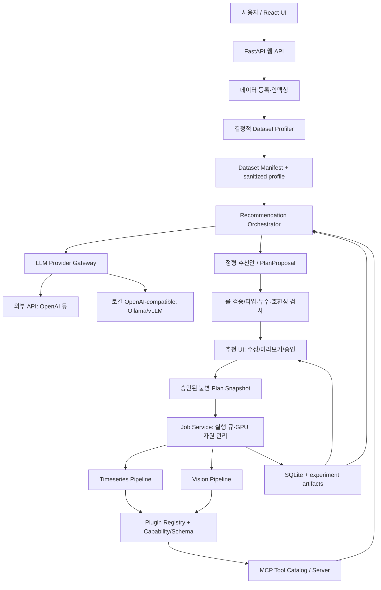

# ARCHITECTURE — LLM + MCP 기반 모듈형 ML Workbench

> 버전 0.2 / 2026-11-19 / **설계 문서이며 구현 결과가 아님**  
> 사용 목적: 반복되는 **시계열 예측·비전 이상탐지/세그멘테이션** 실험 자동화.  
> 최우선 가치: **사용자 통제**, 모듈 추가/제거 용이성, 실험 재현성, 데이터 누수 방지.

## 1. 제품 정의와 개발 범위

이 도구는 모델이 데이터 구조를 살펴 **실행 가능한 전처리/모델 후보를 제안**하고, 사용자가 조정한 구성으로 학습을 돌리는 **반자동 ML 연구 워크벤치**이다. LLM이 직접 임의 코드를 만들거나 서버 명령을 실행하는 완전자율 AutoML은 목표가 아니다.

- 입력: CSV, XLSX(시트 선택), 이미지 폴더/ZIP (로컬 폴더도 등록 가능).
- 우선 태스크: `timeseries.forecasting`, `vision.anomaly_detection`, `vision.segmentation`.
- 시계열 모델: XGBoost → LightGBM → LSTM/GRU-LSTM/CNN1D/RCNN.
- 비전 모델: PatchCore → Dinomaly, PatchCore+Dinomaly, YOLO11-seg → SuperAD/EfficientAD(후보; 성능·구현 검증 후 추가).
- 시계열 전처리: 시간 정렬, 세션 분리, 리샘플링, 결측치 처리, lag/rolling/diff, 시간 특징, scaling.
- 비전 전처리: resize, normalize, ROI, train-only augmentation, 마스크 매핑/리사이즈.
- 초기는 **단일 사용자의 로컬 실행**을 기준으로 한다. 한글 화면은 **React + TypeScript**, Python 서비스 연결은 **FastAPI**로 구성한다. 웹 API는 기존 Application Service를 호출한다.
- 비목표: 학습 파이프라인을 LLM 자동 생성 코드로 실행, 모든 논문 모델 즉시 지원, 회사 비밀자료 외부 업로드, 완전 자동 모델 배포, 사내 공용 LLM 서버 설치.

## 2. 상위 아키텍처



**정확한 역할 구분:** LLM 모델이 MCP 서버에 직접 연결되는 것이 아니라, **Workbench 백엔드가 MCP Host/Client 역할**을 하여 도구 목록을 탐색하고 도구 호출을 중개한다. 추천 중에는 읽기 전용 MCP 도구만 노출하고, 학습·취소 같은 실행 도구는 승인 규칙을 통과한 백엔드에서 호출한다. MCP는 도구 **인터페이스**, Python 레지스트리/학습 엔진은 **실제 구현체**다.

### 컴포넌트 경계

| 계층 | 책임 | 금지할 일 |
|---|---|---|
| Dataset Ingestion | 파일 유효성, 경로, 메타데이터, 버전, 접근권한 | 파일명만 보고 정답 레이블 확정 |
| Dataset Profiler | 로컬에서 구조·통계·폴더/라벨 패턴 결정적으로 수집 | raw 이미지/엑셀 본문을 기본으로 외부 전송 |
| Plugin Registry | 모델/전처리/평가기 메타데이터와 Pydantic schema | 신뢰하지 않는 플러그인을 자동 설치/실행 |
| MCP Server | 레지스트리/서비스를 안전한 typed tools로 노출 | 별도 ML 구현 복제, 임의 shell 실행 |
| Recommendation Orchestrator | 도구 목록/메타데이터+프로파일을 LLM에 제공, 추천 수집 | 검증 없는 tool 결과를 신뢰, 학습 자동 시작 |
| Provider Gateway | 공급자별 API 차이·인증·JSON/툴 지원 추상화 | 특정 공급자 SDK를 핵심 학습 엔진에 전파 |
| Validator | 데이터/모델/전처리 계약, 누수, 리소스, 보안 검증 | LLM 설명문만 보고 승인 |
| UI | 추천 설명, 순서 변경, 파라미터 편집, 승인/비교 | 백엔드 우회 실행 |
| Job Runner | 불변 승인 설정으로 프로세스 실행·상태·로그·취소 | LLM 응답 자체를 코드로 `exec` |
| Storage | run/config/버전/아티팩트/평가 프로토콜 | API 키·원시 데이터 비인가 로깅 |

## 3. 데이터 업로드와 프로파일링 (LLM 호출 이전)

### 3.1 테이블/시계열 CSV·XLSX

- 로컬 탐색: 시트 이름/선택한 시트, 행·열 개수, 컬럼명/타입 추정, null 비율, 범주형 cardinality, 수치 분포(요약값), 중복 키, 시간 후보, 단위(확실하지 않으면 미상), 그룹/설비 ID 후보.
- 시간 분석: 파싱 성공률, 간격 분포, 타임스탬프 중복/역순, 세션 경계 후보, 불규칙 샘플링, 목표 horizon 실현 가능 여부.
- 출력: `DatasetManifest`에 `dataset_id`, 파일 경로(로컬만), 파일 해시/버전, 전체/샘플 건수, schema 및 `safe_profile` 저장.
- 타깃은 AI가 **후보로 제시할 수 있지만 사용자가 확정**해야 함. `timestamp`, `target`, `group_id`, `horizon`, 예측 문제 유형도 확인.
- 프로파일러가 결측/데이터 타입을 판단하는 것이지 LLM이 원본 파일을 열어 직접 파싱하는 게 아님.
- 기본값으로 컬럼 이름도 전송 전 검토·필요하면 별칭 치환. 자유 텍스트 셀 값·개별 설비 ID·고유명·경로는 외부 전송 금지.

### 3.2 이미지 폴더/ZIP

- 폴더 트리 깊이·패턴(상위 N레벨), 이미지 수, 포맷, 크기 분포, 샘플링된 손상 파일, train/val/test, normal/defect 폴더, GT mask/YOLO label 후보 경로 탐지.
- 태스크 제안: `train/good` 중심이면 정상 기반 이상탐지 후보, `images/labels` + `data.yaml`이면 지도학습 seg 후보. **폴더명만으로 확정하지 않고 사용자 확인.**
- 출력: 절대경로를 외부로 보내지 않는 상대 논리 경로·counts·class candidate·sampled resolutions·mask coverage 비율.
- GT label ID ↔ class mapping, 이미지 ↔ mask pairing 검증. `PIL` 이미지/마스크 크기와 orientation 확인, GT nearest-neighbor resize.
- ZIP 경로 순회(`../`), 압축폭탄, symlink, 비정상 확장자 제한 및 저장용량 사전 검증.

### 3.3 LLM용 페이로드

```json
{
  "dataset_id": "ds_2f8c",
  "modality_guess": "timeseries",
  "profile": {
    "rows": 15468,
    "columns": [{"name": "timestamp", "dtype": "datetime"}, {"name": "sensor_1", "dtype": "float", "null_pct": 0.03}],
    "sampling_interval_candidates": ["5min"],
    "group_count": 42
  },
  "user_goal": {"task": "forecasting", "target": "sensor_1", "horizons": ["15min", "30min"]},
  "available_capabilities": ["ts.resample@1", "ts.lag@1", "timeseries.forecasting.xgboost@1"]
}
```

위 숫자와 컬럼명은 **예시**이며, 실제 프로파일러 결과/사용자 설정에 맞게 생성. 미승인 회사 데이터는 외부 LLM에 전송하지 않고 local-only/heuristic 모드 또는 입력 일부 비식별화 정책 적용.

## 4. LLM Provider 교체 설계

`LLMProvider` 인터페이스를 만들고 선택 가능한 구현을 둔다.

- `OpenAIProvider`: 공식 외부 API (키는 환경변수).
- `OpenAICompatibleProvider`: Ollama, vLLM 등 OpenAI 호환 Chat API 서버. URL·model·auth_mode만 변경.
- `MockProvider`: 항상 존재. 테스트/오프라인용 검증 가능한 고정 추천.
- `AnthropicProvider` 등은 추후 독립 어댑터 (API URL만 OpenAI형으로 바꾸면 반드시 작동하는 것은 아님).

**중요:** 공통의 `generate_plan(profile, available_tools) -> PlanProposal` 계약만 보장하면 된다. 공급자별 `tools` 또는 `response_format` 지원의 차이는 `ProviderCapabilities` 확인 및 **JSON-only fallback → 구조 검증 → 오류 시 1회 재요청/오프라인 추천**으로 흡수한다. OpenAI 호환 API라도 기능과 응답 형식이 모델·서버 버전마다 다를 수 있으므로 실제 연결 테스트 필요.

설정 예시는 `examples/providers.yaml`; `base_url`, `model`, `auth_mode`, `api_key_env`, `timeout_s`, `max_tokens`, `max_profile_chars`, `allow_external_data` 등을 선언. 실제 키는 `.env`/OS 환경변수에서만 로딩하고 config, logs, DB, Git에 넣지 않는다. Ollama 기본 로컬 API는 인증을 검증하지 않으므로 SDK가 더미 키를 요구해도 이를 실제 보안용 API 키로 오해하지 않는다. 사내 원격 노출은 인증 프록시/방화벽 등 별도 조치 필요.

**공급자 전환 테스트:** 외부↔로컬을 바꿔 같은 synthetic `safe_profile`과 mock catalog를 넣었을 때 정형 결과 스키마를 만족하고, 비호환 도구 id는 동일 validator가 차단해야 함. 품질 동일성까지 보장하진 않는다.

## 5. MCP 설계: LLM 추천 ↔ 실제 실행 분리

### MCP와 내부 레지스트리의 관계

- **Registry = 기능의 단일 진실 공급원.** tool의 `id`, `description`, `input_schema`, 출력 타입, 요구 컬럼/라벨, modality/task, GPU 필요, 처리 가능한 데이터 조건, installed/ready 여부를 선언.
- MCP server는 레지스트리와 Application Service를 감싼 **얇은 wrapper**. 현재 UI가 꼭 MCP를 통해 학습해야 하는 건 아니지만, AI/외부 MCP client에도 동일한 도구를 개방할 수 있다.
- Workbench(호스트)에 embedded MCP client를 두어 `list_tools`/read-only calls를 사용. 1차는 stdio transport; 필요할 때 Streamable HTTP + 서버 인증.

### MCP Tool 목록

| Tool ID | 용도 | 부작용/권한 |
|---|---|---|
| `dataset.get_profile` | 등록된 파일의 구조적·비식별 요약 | 읽기 전용 |
| `catalog.list_preprocessors` | 전처리 목록/설명/스키마/실행가능성 | 읽기 전용 |
| `catalog.list_models` | 태스크별 모델 목록/요건/스키마 | 읽기 전용 |
| `pipeline.validate` | 추천 plan의 타입·입출력·누수·의존성·리소스 검증 | 읽기 전용 |
| `pipeline.preview` | 소량 샘플에서 전처리 결과 미리보기 | 제한된 계산/읽기 전용 |
| `experiment.estimate_resources` | 예상 GPU/CPU/시간(불확실성 명시) | 읽기 전용 |
| `experiment.get_status` | run ID로 진행 상태 조회 | 읽기 전용 |
| `experiment.get_results` | 완료된 metrics/artifacts 조회 | 읽기 전용 |
| `experiment.compare` | 동일 프로토콜 실험 비교 | 읽기 전용 |
| `experiment.submit` | 승인된 snapshot의 학습 작업 큐 등록 | **쓰기: 사용자 승인 필수** |
| `experiment.cancel` | 진행 중인 작업 종료 요청 | **쓰기: 별도 확인 필수** |

추천 단계에서 모델에 제공하는 MCP tool은 **read-only allowlist**로 제한. 서버 자체의 실행 권한은 LLM의 JSON만으로 열리지 않는다. `experiment.submit`은 UI에서 승인한 **plan_hash/approval_id**를 받아 실행자 신원을 확인해야 한다. `approval_id`는 모델에 보내지 않고 서버에서 검증한다. 특정 모델의 학습기·선택지 노출은 Plugin Registry가 제공.

## 6. 추천 → 승인 → 실행 상태기계

```text
REGISTERED → PROFILED → GOAL_CONFIRMED → RECOMMENDED
                                       ↘ MANUAL_EDIT
RECOMMENDED / MANUAL_EDIT → VALIDATED → PREVIEWED(optional)
                               ↘ NEEDS_FIX
VALIDATED → USER_APPROVED → QUEUED → RUNNING → SUCCEEDED / FAILED / CANCELED
```

1. 데이터 프로파일로부터 모델이 `PlanProposal` 생성(추천 후보 1~3개와 이유·불확실성·전처리 순서 포함).
2. validator가 **등록된 tool인지, modality/task, 컬럼/라벨, 파라미터 범위, split/누수, 입출력 호환성**을 확인한다. 경고는 UI 표시. 중요 오류가 있으면 승인 버튼 비활성.
3. 사용자가 플러그인을 켜고 끄거나 이동하고, 수치·모델·평가 방식을 변경한다. 변경 때마다 **즉시 재검증**.
4. UI가 승인 시 정확한 `PlanSnapshot`을 DB에 불변 상태로 저장하고, 그 해시를 승인 기록에 결합. 이후 수정하면 승인 무효.
5. runner가 승인한 snapshot만 subprocess에서 실행. 서버 경로/모델 id/파라미터는 모두 `Pydantic`/registry로 검증하고, **LLM 텍스트/생성 Python 코드를 직접 실행하지 않는다.**
6. 완료 후 분석을 원하면 저장된 **요약 지표만** 다시 LLM에 전달하여 다음 실험 아이디어 추천. 새로운 실험은 다시 승인 필요.

**LLM 장애/미연결 시:** 프로파일과 Registry를 기반으로 수동 설정 또는 작은 deterministic rule 추천으로 동일 UI/학습 흐름 진행 가능해야 한다.

## 7. 데이터 타입별 학습 엔진

### 시계열 예측

- 타깃, 그룹/설비, timestamp, horizon, sampling interval을 UI에서 확인.
- 기본 분리: 시간순 train 70%/val 15%/test 15% (상황별 walk-forward / group holdout 선택).
- `fit(train)` 전용 통계 전처리. `lag`, `rolling`은 과거 정보만, 세션 경계·예측 horizon 경계 보호. 미래 타깃이 피처에 섞이지 않게 자동 검사.
- 플러그인: `ts.session_split`, `ts.resample`, `ts.missing`, `ts.lag`, `ts.rolling`, `ts.diff`, `ts.calendar`, `ts.scale`, `ts.custom`. 리샘플/분할 단계는 **안전한 실행 계획 컴파일러**에서 순서 고정/제약 확인.
- 모델: `timeseries.forecasting.xgboost` 우선 → LightGBM → LSTM/GRU-LSTM/CNN1D/RCNN (사용자 기존 코드 아키텍처 검토 후 어댑터).
- 지표: MAE, RMSE, R², 설정된 경우 sMAPE, 설비별/예측 구간별 결과, naive baseline.

### 비전 (정상 기반 anomaly / 지도학습 segmentation 구분)

- `DatasetManifest`에 정상 train, calibration, validation, test, GT mask/YOLO label 등을 명시. 없는 라벨은 없는 것으로 처리.
- normal-only: PatchCore 기준 → Dinomaly, 앙상블, SuperAD, EfficientAD 후보 추가. train normal만 이용하고 calibration/val/test를 중복 사용하지 않음.
- segmentation: YOLO11-seg는 GT labels/masks가 필요하므로, normal-only 데이터에는 자동 추천하지 않음.
- 평가: `image/auroc`, `image/ng_recall_at_threshold`, `image/normal_fpr_at_threshold`, `pixel/aupro_0.05`, `pixel/aupro_0.30`, `segmentation/mAP`. GT가 없으면 픽셀 지표 `N/A` + 이유.
- **AU-PRO**: 픽셀 anomaly map에 여러 픽셀 임계값을 적용해 PRO–pixel FPR 곡선을 만들고 0~상한(0.05/0.30) 구간을 정규화 적분. 이미지 단위 오판율과 구별. 계산에 사용한 threshold grid, interpolation, 집계/정규화 방식을 기록.
- 기존 VisA, MVTec AD 1/2, BTAD importer는 서로 다른 레이블/스플릿 구조이므로 어댑터로 분리.

### 모듈 확장

사용자 정의 전처리는 **신뢰된 로컬 Python 플러그인**으로 구현하고 Registry가 `manifest+schema`를 자동 발견. 모델/평가기 역시 `PluginSpec` 사용. 새로운 플러그인은 core 모듈 수정 없이 등록되는 것이 원칙. 정형 schema, input/output capability, 의존성 설치 상태, 버전, 단위 테스트 필수.

## 8. 실험 기록과 리소스

- 웹 UI는 React, 웹 API는 FastAPI를 사용한다. Python 핵심 기능은 Pydantic, SQLite, 파일 아티팩트를 사용하고, worker는 개별 Python 프로세스로 실행한다.
- 서버에서 동시 GPU 학습 기본 **1개**, GPU 공유 자원 감지, 대기/취소/실패 복구. 추론/학습 프로세스가 서로 다른 가상환경을 쓸 수 있도록 worker adapter 사용.
- 저장: `run_id`, `dataset_id/hash`, `provider_id` (API 키 제외), `recommendation_model`, `recommendation_version`, `tool_catalog_version`, `plan_hash`, `plugin_ids@versions`, seed, split, config, Python/CUDA/패키지 버전, metrics, predictions, plots, checkpoint, logs.
- 이전 실험과 비교 시 **데이터셋/스플릿/GT/이미지 해상도/metric protocol**이 다르면 UI에 경고. 동일 지표처럼 보이는 숫자의 무분별한 순위 매기기 금지.
- LLM 호출 로그는 raw prompt/응답 대신 기본적으로 schema/상태/비용 추정/지연시간만 저장. 디버그 전문 저장은 사용자 승인 및 민감정보 검토 후 허용.

저장 예시:

```text
workspace/
  datasets/<dataset_id>/manifest.json
  plans/<plan_id>/proposal.json
  plans/<plan_id>/approved_snapshot.yaml
  experiments/<run_id>/
    config.yaml
    dataset_manifest.json
    environment.json
    metrics.json
    metrics_meta.json
    predictions/
    plots/
    model/
    train.log
  mlwb.sqlite
```

## 9. 사용자 UI 화면 설계

1. **Dataset Explorer:** 파일·폴더 업로드/등록 → 탐지된 시트/컬럼 또는 폴더/마스크/라벨 구조 → 타깃·예측 목표·태스크 확정.
2. **AI Recommendation:** 현재 Provider 표시, 요약 전송 범위 미리보기, 추천 전처리 순서·모델 후보·근거·주의사항 및 대체안.
3. **Pipeline Builder:** 블록 추가/삭제/재정렬, 파라미터 편집, schema 기반 입력 UI, `validate`/`preview`, YAML 저장·불러오기.
4. **Training Runs:** 승인 요약 및 변경사항 diff, 버튼 클릭 후 큐/로그/진행률/취소.
5. **Experiment Compare:** 프로토콜이 같은 실험끼리 지표·그래프 비교, 모델/예측 내보내기, (선택) 다음 실험 추천.
6. **Plugins & LLM Settings:** 플러그인 설치 상태, 서버 연결 확인, Provider profile(OpenAI/Ollama/vLLM/Mock), model/키 환경변수, 데이터 외부 전송 정책.

## 10. 폴더 구조 (목표)

```text
ml-workbench/
├── README.md
├── CLAUDE.md                    # docs/의 작업 규칙으로 안내
├── docs/
│   ├── CLAUDE.md
│   ├── ARCHITECTURE.md
│   ├── CONTRACTS.md
│   ├── PROGRESS.md
│   ├── REQUIREMENTS.md
│   ├── SCREEN_DESIGN.md
│   └── *_BRIEF.md               # 단계별 구현 지시
├── pyproject.toml
├── .env.example                 # 키 이름 예시만, 실제 비밀키 금지
├── configs/{providers.yaml,pipelines/}
├── frontend/                    # React + TypeScript
├── src/mlworkbench/
│   ├── cli.py
│   ├── api/                     # FastAPI 라우트·웹 응답
│   ├── app/{dataset_service,recommend_service,plan_service,job_service}/
│   ├── datasets/{ingest,profile,manifest,timeseries,vision,split}/
│   ├── llm/{gateway,protocol,providers,capabilities,prompts,parsers}/
│   ├── mcp/{server,client,tool_facade}/
│   ├── core/{contracts,registry,validation,errors,security}/
│   ├── plugins/{preprocessing,models,evaluators}/
│   ├── pipelines/{timeseries,vision,compiler}/
│   ├── runner/{jobs,worker,gpu_guard}/
│   ├── storage/{database,artifacts}/
│   └── reporting/{metrics,compare,export}/
├── tests/{unit,integration,security,fixtures}/
└── workspace/{datasets,plans,experiments,mlwb.sqlite}   # .gitignore
```

**의존성 규칙:** React UI → FastAPI → Application Services → Python 핵심 모듈. 웹 API, CLI, MCP는 같은 Application Services를 사용한다. 업로드·프로파일링, 검증·승인, 실행은 Python 서비스가 담당한다. 브라우저 응답에는 로컬 절대경로나 비밀키를 포함하지 않는다. Plugins에 UI·LLM API·DB import 금지.

## 11. 실패 조건 및 안전장치

- 손상 데이터/폴더, 존재하지 않는 타깃·마스크, 잘못된 split, 부적절한 전처리 순서 → 사용자에게 이유 표시, 실행 차단.
- 공급자 인증 실패/시간초과/요금 제한/지원하지 않는 structured output → retry/서킷 브레이커/수동 모드, 모델 지어내기 금지.
- LLM이 없는 도구나 임의 Python 명령을 제안 → 불허. 추천 이유는 설명용일 뿐 명령으로 사용하지 않음.
- 외부 API의 개인정보·영업비밀 전송 → 기본 차단; 요약 전송 미리보기 및 사용자가 허용한 범위만. raw 이미지/원시 테이블 전송은 기본 사용 안 함.
- Tool 응답/CSV 필드명 등에 있는 프롬프트 인젝션 → 외부 비신뢰 데이터로 취급, 상위 정책·승인 규칙 우회 불가.
- 같은 모델을 여러 GPU 실행이 차지하거나 OOM 발생 → 동시 실행 제한/자원 모니터링/실패 격리.
- 프로바이더를 바꾸더라도 기존 실험 재현은 승인된 PlanSnapshot/모델 버전에 기반하므로 LLM 재추천에 의존하지 않음.

## 12. 확장 포인트 및 단계 원칙

**가장 먼저 만들 것은 모델 전체가 아니라 _프로파일→도구 검색→추천(JSON)→검증→사용자 승인_의 일관된 구조**다. 이후 시계열 한 모델로 첫 학습 성공, 비전 PatchCore로 두 번째 학습 성공, 모델군 확장 순서로 진행한다.

- 추천 품질을 향상하려면 프롬프트만 수정하는 것이 아니라 `PluginSpec` 설명/제약/실험 결과 메타데이터를 개선한다.
- LLM 선택 변경은 `providers.yaml`과 환경변수만 변경, 공통 `PlanProposal`·학습 엔진 수정 금지.
- CLI/웹/Claude MCP 클라이언트는 동일한 Application Service를 사용한다.
- 회사 GPU(예: RTX 5090 32GB)는 학습 서버와 리소스를 공유할 수 있으므로 로컬 LLM은 옵션으로 남기고, 기본 초기 구현은 **외부 API/Mock** 중심으로 한다.
