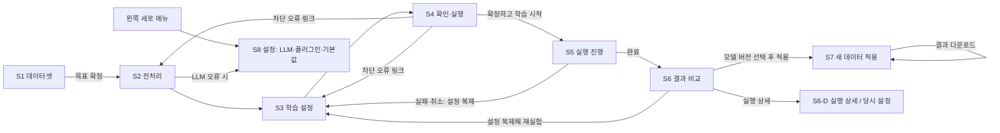

# SCREEN_DESIGN — ML Workbench 화면 설계서

> 버전 0.1 / 2026-11-19 / 근거 문서: `REQUIREMENTS.md`, `ARCHITECTURE.md`, `CONTRACTS.md`, `PROGRESS.md`
> **설계 문서이며 구현 결과가 아님.** 대상 UI는 React + TypeScript이며, 단일 사용자 로컬 환경에서 FastAPI와 연결한다.
> 와이어프레임은 레이아웃·정보 구조를 보여주는 텍스트 도식이다. 숫자·컬럼명·폴더명은 모두 **예시**다.

---

## 0. 요약

| 항목 | 결정 |
|---|---|
| 전체 흐름 | **① 데이터셋 → ② 전처리 → ③ 학습 설정(모델·학습량·평가) → ④ 확인·실행 → ⑤ 실행·결과 → ⑥ 새 데이터 적용** |
| 내비게이션 | 맨 왼쪽 세로 메뉴. 확인·실행은 학습 설정의 마지막 화면이며 설정은 메뉴 하단에 배치 |
| 학습량·평가 배치 | **별도 단계로 두지 않고 ③ 학습 설정 탭의 세 섹션으로 묶음** (근거: §3.1) |
| 승인 시점 | ④ 확인·실행 화면의 "확정하고 학습 시작" 한 번. 그 이전 단계의 수정은 모두 초안(draft) |
| LLM 미연결 | 모든 단계가 수동/규칙 기반 추천으로 동일하게 진행됨. 화면 구조는 바뀌지 않음 |
| 계약 검토 | §13에서 11건을 추적하며, 구현 기준은 `CONTRACTS.md` §11에 기록 |

---

## 1. 요구사항 ↔ 화면 매핑

| 요구사항 ID | 화면 ID | 화면/영역 |
|---|---|---|
| DATA-01 | S1 | 데이터셋 — 왼쪽 업로드·등록 목록 / 오른쪽 구조 패널 |
| DATA-02 | S1-T | 데이터셋 — 오른쪽 **시계열 구조 패널**(시트·행 수·피처·타입·목표 확인) |
| DATA-03 | S1-V | 데이터셋 — 오른쪽 **이미지 구조 패널**(폴더 트리·예시 이미지·라벨 구조 확인) |
| PREP-01 | S2 | 전처리 — 추천 카드(무엇을/왜) |
| PREP-02 | S2 | 전처리 — 체크·파라미터 편집·순서 조정·호환성 표시·수동 추가 |
| TRAIN-01 | S3 §B | 학습 설정 — 학습 데이터량 섹션 |
| EVAL-01 | S3 §C | 학습 설정 — 분할·평가 섹션 |
| EVAL-02 | S3 상단 / S6 | 학습 설정 — "내 기본값 불러오기/저장" + 실행 상세에서 당시 설정 보기 |
| RUN-01 | S4 | 확인·실행 — 전체 요약·차단 오류·확정 |
| RUN-02 | S5 | 실행 — 상태·현재 단계·진행률/경과 시간 |
| RESULT-01 | S6 | 결과 비교 — 실험 표·조건 차이 경고 |
| APPLY-01 | S7 | 새 데이터 적용 — 모델 버전 선택·입력 조건 점검·결과 확인·다운로드 |
| 공통(LLM 전송) | S2 상단 / S8 | 전송 요약 미리보기·허용 / 설정 화면의 정책 |
| 공통(MLflow) | — | 화면에 MLflow 링크를 요구하지 않음. 버전·기록은 S6/S7 안에서 표시 |

---

## 2. 공통 레이아웃과 상태 규칙

### 2.1 앱 셸

전용 상단 바에는 워크벤치 이름과 데이터셋 이름 검색을 배치한다. Windows 데스크톱 창은 이 바 오른쪽에 최소화·최대화·닫기 버튼을 두고, 이름 주변과 검색 오른쪽 빈 영역을 드래그해 창을 이동할 수 있게 한다.

```
┌───────────────┬──────────────────────────────────────────────────────────────┐
│ ML Workbench  │ 데이터셋                                                     │
├───────────────┼──────────────────────┬───────────────────────────────────────┤
│ ● 데이터셋    │ 파일 올리기          │ 선택한 데이터 구조                    │
│   전처리      │ 등록 목록            │ sensor_A.csv · 15,468행 · 12열        │
│   학습 설정   │ sensor_A.csv · 완료  │ 피처 목록 · 시간열 후보               │
│   실행·결과   │ line2.csv · 분석 중  │                                       │
│   새 데이터 적용│                     │                                       │
│               │                      │                                       │
│   설정        │                      │                                       │
└───────────────┴──────────────────────┴───────────────────────────────────────┘
```

- **세로 메뉴:** 아이콘과 짧은 한글 이름을 사용하고, 선택한 항목만 배경이나 강조선으로 표시한다. 메뉴 사이를 이동해도 탐색 영역은 같은 위치에 둔다. 현재 위치와 잠김 사유는 키보드와 보조기술로도 확인할 수 있게 한다.
- **진입 규칙:** 데이터셋과 목표가 확정되면 전처리·학습 설정으로 진행할 수 있다. S4 확인·실행은 학습 설정의 마지막 화면으로 이동하며 현재 메뉴는 학습 설정으로 표시한다. 실행 기록과 적용 가능한 모델은 각각 실행·결과와 새 데이터 적용 화면의 진입 조건으로 사용한다. 첫 CSV 화면 구현에서는 사용 가능한 데이터셋 메뉴를 활성화하고 후속 화면은 연결 예정 상태로 표시한다.
- 추천 LLM 상태와 외부 전송 정책은 전처리 화면의 추천 출처 영역에서 확인한다. 실제 실행 상태는 실행·결과에서 확인하며 작업이 진행 중일 때만 해당 메뉴에 상태를 표시한다.
- **시각 기준:** 데이터 작업 화면답게 여백과 정렬로 영역을 구분한다. 한글 레이블과 표의 행 수·타입이 먼저 읽히도록 크기와 간격을 잡고, 이미지 미리보기는 일정한 크기로 배치한다. 완료·오류 같은 상태는 색과 함께 텍스트로 표시한다.
- **첫 화면 배치:** 넓은 화면에서는 고정 세로 메뉴의 오른쪽 본문을 업로드·목록과 구조 패널로 약 30:70으로 나눈다. 좁은 창에서는 세로 메뉴를 아이콘 중심으로 줄이고 포커스나 툴팁으로 이름을 확인할 수 있게 한다. 본문은 업로드·목록 아래에 구조 패널을 배치한다.

### 2.2 공통 상태 표기

| 상태 | 표기 원칙 |
|---|---|
| 빈 상태 | 무엇이 없는지 + 다음 행동 버튼 1개 ("데이터셋을 업로드하세요 [파일 선택]") |
| 로딩 | 대상과 단계 명시 ("sensor_A.csv 분석 중 — 시간열 파싱"). 5초 이상이면 경과 시간 표시 |
| 오류 | 원인(한글) + 조치 + 상세(접힘: 오류 코드). 원시 경로·키 값은 표시하지 않음 |
| 경고 | 실행은 가능. 노란 배지 + 이유 |
| 차단 | 실행 불가. 빨간 배지 + "조치할 항목" 링크(해당 단계·필드로 이동) |

### 2.3 초안·승인 규칙 (화면 관점)

- ②·③에서의 모든 변경은 **초안(Plan draft)** 에 즉시 저장되고, 변경마다 `pipeline.validate`를 다시 호출한다(디바운스 0.5초).
- 승인은 ④에서만 발생한다. 승인 후 ②·③을 수정하면 "이전 확정이 무효화되었습니다" 배너가 뜨고 ④에서 다시 확정해야 한다.
- LLM이 쓴 문장(추천 이유 등)은 **설명용 텍스트**로만 표시한다. 버튼·링크·명령으로 렌더링하지 않는다(프롬프트 인젝션 대비, `ARCHITECTURE.md §11`).

---

## 3. 배치 결정과 근거

### 3.1 학습량·평가를 전용 단계로 둘지, 학습 설정에 묶을지 → **"③ 학습 설정" 한 탭에 세 섹션으로 묶음**

| 대안 | 장점 | 단점 |
|---|---|---|
| A. 학습량·평가 각각 별도 단계 | 요구사항 표와 1:1 대응 | 단계 8개로 길어짐. 학습량(학습 구간)·분할·평가가 서로 의존하는데 화면이 갈라져 변경 영향이 안 보임 |
| **B. ③ 학습 설정 = 모델 + 학습량 + 분할·평가 (채택)** | 학습량 변경이 "학습 구간만 줄고 검증·테스트는 유지"되는 걸 **같은 분할 타임라인 위에서** 보여줄 수 있음. 모델 선택에 따라 가능한 평가(예: GT 필요 지표)가 바로 바뀜 | 한 화면이 길어짐 → 섹션 접기와 섹션별 검증 배지로 보완 |
| C. ④ 확인 화면에 모두 포함 | 단계 최소 | "확인"과 "설정"이 섞여 승인 의미가 흐려짐 |

**근거:** 모델, 학습량, 분할, 평가 설정은 같은 실행 계획에 저장하고 `plan_hash`에 포함한다. 한 화면에서 학습량을 바꿀 때 학습 구간과 평가 구간을 함께 확인할 수 있다.

### 3.2 모델 선택 위치 → ③ 학습 설정의 첫 섹션

추천 모델이 있으면 초안에 반영하고 ③에서 바꿀 수 있다. 수동 모드에서는 모델을 비운 채 ②에서 전처리를 편집하고 ③에서 고른다. 모델과 전처리가 호환되지 않으면 ③에서 이유를 표시하고 ②로 연결한다.

### 3.3 목표 확인(타깃·시간열 등) 위치 → ① 데이터셋 오른쪽 패널 하단

`ARCHITECTURE.md §6` 상태기계에서 `GOAL_CONFIRMED`가 추천 전 단계이고, DATA-02가 "사용자가 시간열, 예측 타깃… 을 확인"을 요구한다. 구조를 본 바로 그 자리에서 확정하는 편이 자연스러워 별도 단계를 만들지 않았다. 확정 전에는 ②가 잠긴다.

### 3.4 결과 비교와 실행 진행을 한 탭(⑤)에 → 상단 서브탭 `[진행 중] [결과 비교]`

실행 직후 사용자는 진행을 보고, 완료 후 같은 자리에서 결과로 넘어간다. 탭을 나누면 완료 알림 후 이동이 한 번 더 생긴다.

### 3.5 순서 조정 방식

이동 가능한 단계에는 키보드로도 조작할 수 있는 위·아래 이동 버튼을 제공한다. 드래그 정렬을 추가하는 경우에도 같은 순서 제약과 키보드 조작을 지원한다. 시간 정렬 같은 고정 단계는 잠금과 이유를 표시한다.

---

## 4. 화면 전환도



---

## 5. S1 데이터셋 (DATA-01/02/03) — 앱 첫 화면

### 목적
데이터를 올리고, 로컬 프로파일러가 분석한 구조를 확인하고, 예측 목표/태스크를 확정한다.

### 주요 구성
- **왼쪽(약 30%) 업로드·등록 목록**
  - 업로드 영역: 파일(CSV/XLSX/ZIP) 드래그·선택, "로컬 폴더 등록" 버튼(이미지 폴더 경로 입력).
  - 등록 목록: 이름, 종류 아이콘(표/이미지), 상태 배지 `업로드 중 n% / 분석 중 / 완료 / 실패`, 등록 시각. 실패 항목은 원인 한 줄과 [다시 시도][삭제].
  - 검색/필터: 종류, 상태.
- **오른쪽(약 70%) 구조 패널** — 선택 항목 종류에 따라 S1-T 또는 S1-V.
- 하단 고정 바: `[목표 확정 후 전처리로 →]` (미확정 시 비활성 + 남은 필수 항목 수).

### S1-T 시계열 구조 (DATA-02) 와이어프레임

```
┌ 데이터셋 ───────────────────┬ sensor_A.xlsx ─────────────────────────────────────────┐
│ [+ 파일 올리기] [폴더 등록]   │ 시트: [ 2026_line1 ▾ ]   (시트 3개)        분석 완료 ✓   │
│                              │ 행 15,468 · 열 12 · 기간 2026-01-03 ~ 2026-03-31          │
│ 🔍 검색        [전체 ▾]      │ 샘플 간격 추정: 5분 (98.2%) · 타임스탬프 중복 0 · 역순 3   │
│ ──────────────────────────── │ ───────────────────────────────────────────────────────── │
│ ▶📈 sensor_A.xlsx   완료 ✓   │  피처 목록                                   [타입 수정]  │
│   📈 line2_log.csv  분석 중… │  이름          타입      결측    고유값   역할(후보)       │
│   🖼 bottle_v1.zip  완료 ✓   │  timestamp     시간      0%      —        ⏱ 시간열 후보    │
│   📈 old.csv        실패 ✕   │  device_id     범주형    0%      42       🏷 설비 구분 후보│
│     └ 시간열 파싱 실패 0%    │  sensor_1      수치      3.0%    —        🎯 타깃 후보     │
│       [다시 시도][삭제]      │  sensor_2      수치      0.4%    —                         │
│                              │  mode          범주형    0%      4                         │
│                              │  …  (펼치기: 7개 더)                                     │
│                              │ ───────────────────────────────────────────────────────── │
│                              │  예측 목표 확인  (AI/프로파일러 후보는 사용자가 확정)       │
│                              │  태스크      (●) 시계열 예측                               │
│                              │  시간열      [ timestamp ▾ ]                               │
│                              │  예측 타깃   [ sensor_1  ▾ ]   *필수                       │
│                              │  설비 구분   [ device_id ▾ ]   (선택)                      │
│                              │  예측 구간   [15분 ×][30분 ×][+ 추가]                      │
│                              │  ⚠ 역순 타임스탬프 3건 → 전처리에서 시간 정렬 필요          │
│                              │                                   [목표 확정 →]           │
└──────────────────────────────┴───────────────────────────────────────────────────────────┘
```

- XLSX는 시트 선택이 바뀌면 프로파일을 해당 시트 기준으로 다시 보여준다(캐시가 없으면 "분석 중").
- 타입 수정: 수치↔범주형↔시간↔제외. 수정은 manifest에 사용자 오버라이드로 기록.
- 셀 원문 미리보기는 **로컬 표시만**(상위 20행, 접힘 기본). 외부 전송 대상이 아님을 아이콘으로 표기.

### S1-V 이미지 구조 (DATA-03) 와이어프레임

```
┌ 데이터셋 ───────────────────┬ bottle_v1.zip ─────────────────────────────────────────┐
│ …(동일 목록)…               │ 입력 이미지 292장 · GT 마스크 63장 · PNG  분석 완료 ✓ │
│ ▶🖼 bottle_v1.zip  완료 ✓   │ 손상 파일 0 (샘플 50장 검사) · 마스크 짝 맞춤 63/63 (100%) │
│                              │ ───────────────────────────────────────────────────────── │
│                              │  폴더 트리                       예시 이미지 (로컬 표시)    │
│                              │  📁 train                        ┌────────┐ ┌────────┐     │
│                              │   └📁 good          209  정상     │  good  │ │ broken │     │
│                              │  📁 test                         │ 000.png│ │ _large │     │
│                              │   ├📁 good           20  정상     └────────┘ └────────┘     │
│                              │   ├📁 broken_large   20  불량     train/good  test/broken_l │
│                              │   ├📁 broken_small   22  불량     [다른 예시 보기]           │
│                              │   └📁 contamination  21  불량                              │
│                              │  📁 ground_truth     63  GT 마스크                          │
│                              │ ───────────────────────────────────────────────────────── │
│                              │  라벨 구조 확인  (폴더명 기반 추정 — 확정 필요)             │
│                              │  폴더              추정 역할          확정                  │
│                              │  train/good        정상 학습          [정상 학습   ▾]       │
│                              │  test/good         정상 평가          [정상 평가   ▾]       │
│                              │  test/broken_*     불량 평가          [불량 평가   ▾]       │
│                              │  ground_truth/*    GT 마스크          [GT 마스크   ▾]       │
│                              │  보정(calibration) 없음 → [정상 학습에서 10% 떼어내기 ☐]     │
│                              │  태스크  (●) 정상 기반 이상탐지  ( ) 세그멘테이션(라벨 필요) │
│                              │                                   [목표 확정 →]           │
└──────────────────────────────┴───────────────────────────────────────────────────────────┘
```

- 예시 1~2장: 정상 1장 + 불량 1장 우선. 표시 불가 시 회색 박스에 사유: "지원하지 않는 형식(.bmp 16bit)", "손상 파일", "ZIP 압축 해제 전 — [미리보기용 해제]", "용량 초과(> 50MB)".
- 세그멘테이션은 라벨/마스크가 없으면 선택지 비활성 + "GT 라벨이 없어 선택할 수 없음".
- ZIP 보안 검사(경로 순회·압축폭탄·심볼릭 링크) 실패 시 상태 `실패` + "안전하지 않은 ZIP 항목 3개" 상세.

### 사용자 동작
업로드/등록 → 목록에서 선택 → (XLSX) 시트 선택 → 타입·역할 확인/수정 → 목표 확정 → ②로 이동.

### 상태
| 상태 | 왼쪽 목록 | 오른쪽 패널 |
|---|---|---|
| 빈 상태(첫 실행) | "등록된 데이터셋이 없습니다" + 업로드 영역 강조 | 지원 형식 안내(CSV, XLSX, 이미지 폴더/ZIP)와 "데이터는 이 PC에서만 분석됩니다" |
| 업로드 중 | 진행률 % | "업로드가 끝나면 자동으로 분석합니다" |
| 분석 중 | 스피너 + 현재 단계(시트 읽기/시간열 파싱/폴더 스캔/마스크 매칭) | 단계 체크리스트 스켈레톤 |
| 완료 | ✓ | 구조 패널 |
| 실패 | ✕ + 원인 한 줄 | 원인·조치("시간열을 찾지 못함 → 타입 수정에서 시간열 지정") + 부분 결과가 있으면 함께 표시 |
| 목표 미확정 | — | 하단 바에 "필수 2개 남음: 예측 타깃, 예측 구간" |

---

## 6. S2 전처리 (PREP-01/02)

### 목적
선택한 데이터셋·목표에 대한 LLM 기본 추천을 보고, 실행할 전처리 단계와 순서·파라미터를 정한다.

### 주요 구성
1. **추천 출처 바:** `추천: Mock(오프라인) · 2026-11-19 14:02 · 카탈로그 v3 [다시 추천] [수동으로 시작]`
2. **외부 전송 확인(외부 LLM일 때만):** 처음 추천 요청 전 "전송 요약 미리보기" 패널 — 전송할 항목(컬럼명/별칭, 타입, 결측률, 행 수, 간격 후보, 카탈로그 id)과 **보내지 않는 항목**(셀 값, 설비 ID 값, 절대경로, 이미지 픽셀)을 나란히 표시. `[이번만 허용] [항상 허용(설정에 저장)] [로컬/Mock으로 추천]`.
3. **실행 순서 목록(왼쪽 60%)**: 단계 카드 목록. 체크된 단계만 실행되며 번호는 실행 순서.
4. **세부 패널(오른쪽 40%)**: 선택한 카드의 무엇을 하는지(플러그인 설명), 왜 추천했는지(LLM 이유), 파라미터 폼(`parameter_schema` 기반 자동 생성), 미리보기 결과.
5. **하단 검증 바:** `검증 ✓ 통과 · 경고 1` 또는 `✕ 오류 2 — 실행 불가`. [미리보기] [다음: 학습 설정 →]

### 와이어프레임 (시계열)

```
┌ ② 전처리 ─────────────────────────────────────────────────────────────────────────────┐
│ 추천: Mock(오프라인) · 카탈로그 v3 · 14:02         [다시 추천] [추천 버리고 수동으로]   │
├───────────────────────────────────────────────┬───────────────────────────────────────┤
│ 실행 순서 (체크된 항목만 실행)                  │ ③ lag 피처 (ts.lag@1.0.0)             │
│   1 🔒 시간 정렬             자동 적용 │ 무엇을 하나요                          │
│ ☑ 2 🔒 세션 분리 gap=30분   ts.session_split │  과거 시점 값을 새 입력 피처로 추가.    │
│ ☑ 3    리샘플 15분·평균      ts.resample ▲▼ AI추천│  세션 경계를 넘지 않음.                │
│ ☑ 4    결측 보간 선형        ts.missing  ▲▼ AI추천│ 이 데이터에 추천한 이유 (AI 설명)       │
│ ▶☑ 5   lag 1,2,4,8          ts.lag      ▲▼ AI추천│  "sensor_1의 자기상관이 높아 직전       │
│ ☐ 6    rolling 평균 2,4,8   ts.rolling  ▲▼ AI추천│   관측이 유용함" (설명용 텍스트)        │
│ ☑ 7    스케일링(train fit)  ts.scale    ▲▼ 수동  │ 파라미터                               │
│                                                 │  lags   [1][2][4][8][+]                │
│ ⚠ 6 rolling은 4 결측 보간 뒤에 와야 합니다       │  대상열 [sensor_1 ▾][sensor_2 ▾]        │
│   (현재 순서 OK)                                │  ⓘ 최대 lag 8 × 15분 = 2시간 히스토리 필요│
│ ✕ (예) diff를 resample 앞에 둘 수 없음 [수정]     │ [샘플 500행 미리보기]                   │
│                                                 │  추가된 피처 8개 · 결측 증가 0.2%        │
│ [+ 전처리 추가 ▾] (등록·설치된 플러그인만)        │                                       │
├───────────────────────────────────────────────┴───────────────────────────────────────┤
│ 검증 ✓ 통과 · 경고 1 (rolling 해제됨: 추천 대비 변경)        [미리보기] [다음 →]        │
└───────────────────────────────────────────────────────────────────────────────────────┘
```

- 비전은 같은 구조에 `vision.resize`, `vision.normalize`, ROI, 학습 전용 증강 카드. 증강 카드에는 "학습 데이터에만 적용" 고정 배지. 미리보기는 이미지 원본/변환 썸네일 + 마스크 겹침.
- 카드 배지: `AI추천 / 수동 추가 / 추천 대비 변경됨 / 미설치(실행 불가) / 호환 불가`.
- LLM이 미등록·미설치 플러그인을 추천한 경우: 카드는 회색으로 보여주되 체크 불가, "등록되지 않은 도구(ts.future_value) — 실행할 수 없음" 표시(`CONTRACTS §6`).
- 추가 메뉴는 Registry의 `ready=true` 플러그인만 활성. 미설치는 사유와 함께 비활성 표시.

### 사용자 동작
체크/해제 → ▲▼ 순서 조정(🔒 제외) → 파라미터 편집 → 즉시 재검증 → (선택) 미리보기 → ③으로.

### 상태
| 상태 | 화면 |
|---|---|
| 처음 진입·추천 생성 중 | "추천 생성 중 — 카탈로그 조회 → 추천 요청 → 검증" 3단계 진행 표시. [취소하고 수동으로] |
| LLM 미연결 | 안내 배너 "추천 LLM이 연결되지 않았습니다. 규칙 기반 기본안으로 시작합니다." + [설정으로] |
| 추천 실패(시간초과·스키마 오류·인증 실패) | 원인 + "1회 자동 재시도 실패" + [다시 추천][규칙 기본안][빈 목록에서 수동] |
| 외부 전송 미허용 | 전송 미리보기 패널이 본문 위를 차지, 허용 전엔 외부 추천 요청 안 함 |
| 빈 목록(수동, 아무것도 없음) | "전처리 없이 진행할 수 있습니다. 모델이 요구하는 필수 단계가 있으면 아래에 표시됩니다." |
| 검증 오류 | 해당 카드 빨간 테두리 + 카드 안 이유, 하단 [다음] 비활성 아님(③ 작성은 가능), 단 ④에서 차단 |

> ③으로의 이동은 오류가 있어도 허용한다(설정을 이어 쓰는 흐름 유지). **실행 차단은 ④에서 일괄** 처리.

---

## 7. S3 학습 설정 (모델 + TRAIN-01 + EVAL-01, EVAL-02)

### 목적
모델, 학습에 쓸 데이터량, 분할·평가 방식을 정한다.

### 상단 바 (EVAL-02)
`기본값: [시계열 예측 · 내 기본값 v2 ▾] [불러오기] [현재 설정을 기본값으로 저장]` — 불러오면 변경된 필드에 "기본값에서 불러옴" 표시. 이번 실험에서 바꾼 값은 "기본값과 다름" 점 표시.

### 와이어프레임 (시계열)

```
┌ ③ 학습 설정 ─────────────────────────────────────────────────────────────────────────┐
│ 기본값 [시계열 예측 · 내 기본값 v2 ▾] [불러오기] [현재 설정을 기본값으로 저장]        │
├──────────────────────────────────────────────────────────────────────────────────────┤
│ A. 모델                                                            ✓                  │
│  (●) XGBoost  timeseries.forecasting.xgboost@1.0.0   AI추천 · CPU 가능                 │
│  ( ) LightGBM                                        미설치 — 선택 불가                │
│  파라미터 n_estimators [300]  max_depth [6]  learning_rate [0.1]   [고급 ▾]           │
├──────────────────────────────────────────────────────────────────────────────────────┤
│ B. 학습 데이터량 (TRAIN-01)                                         ✓                  │
│  (●) 학습 구간 전체   ( ) 학습 구간 중 최근 [ 30 ] 일                                  │
│                                                                                        │
│  01-03 ───────────────────── 학습 70% ──────────────┤ 검증 15% ┤ 테스트 15% ┤ 03-31     │
│               ░░░░░░░░ 제외 ░░░░░░│■■■ 사용(최근 30일) ■■│                             │
│  ⓘ 사용량을 줄여도 검증·테스트 구간은 그대로 유지됩니다.                               │
│  실제 학습 사용: 2026-02-01 ~ 2026-03-02 · 8,640행 (기록에 저장)                        │
├──────────────────────────────────────────────────────────────────────────────────────┤
│ C. 분할·평가 (EVAL-01)                                              ⚠ 1               │
│  분할   [시간순 ▾] 학습 [70]% 검증 [15]% 테스트 [15]%   경계 gap [예측구간 최대값 자동] │
│  지표   ☑ MAE  ☑ RMSE  ☐ R²  ☐ sMAPE      집계 ☑ 설비별 ☑ 예측 구간별                │
│  기준 예측(baseline)  [직전값(naive_last_value) ▾]                                     │
│  ⚠ 설비 42개 중 3개는 테스트 구간 데이터가 50행 미만 — 설비별 지표 신뢰도 낮음          │
├──────────────────────────────────────────────────────────────────────────────────────┤
│ 검증 ✓ 통과 · 경고 1                                        [← 전처리] [다음: 확인 →]  │
└──────────────────────────────────────────────────────────────────────────────────────┘
```

### 비전 변형 (차이점만)

```
│ A. 모델   (●) PatchCore  vision.anomaly.patchcore@1.0.0   GPU 필요 · 예상 VRAM 6~9GB    │
│           ( ) YOLO11-seg                                   GT 라벨 없음 — 선택 불가      │
│ B. 학습 데이터량   (●) 정상 학습 이미지 전체(188장)  ( ) [ 50 ]장  샘플링 seed [42]      │
│    ⓘ 보정 21장·평가 83장은 그대로 유지. 사용 이미지 목록 해시를 기록에 저장.             │
│ C. 평가                                                                                  │
│   이미지 지표  ☑ AUROC  ☑ 불량 검출률(NG recall)  ☑ 정상 오판율(정상 이미지 FPR)          │
│   판정 임계값  [보정용 정상 이미지 점수 최대값 ▾]  (다른 규칙: 상위 99% 분위 / 직접 입력) │
│   픽셀 지표    ☑ AU-PRO @0.05  ☑ AU-PRO @0.30                                            │
│                ⓘ AU-PRO는 픽셀 FPR 구간 적분값이며 정상 이미지 오판율과 다른 지표입니다.   │
│   (GT 없는 데이터셋이면) ☐ AU-PRO — 적용 불가: GT 마스크가 없음 (결과에 N/A로 표시)       │
```

### 상태
| 상태 | 화면 |
|---|---|
| 기본값 없음 | 드롭다운에 "저장된 기본값 없음 — 시스템 기본(70/15/15, MAE·RMSE)" |
| 학습량이 너무 적음 | 차단 예시. "선택한 학습 구간에서 필요한 과거 관측과 미래 라벨을 모두 갖춘 샘플이 없습니다. 기간을 늘리거나 lag를 줄이세요." |
| 모델 변경으로 전처리 비호환 | 섹션 A 경고 + "② 전처리의 ts.scale은 이 모델에 불필요 [전처리로 이동]" |
| 자원 추정 중 | 모델 옆 "예상 시간·메모리 계산 중…" (`experiment.estimate_resources`, 불확실성 범위로 표시) |

---

## 8. S4 확인·실행 (RUN-01)

### 목적
실행 전 모든 설정을 한 화면에서 확인하고, 확정(승인) 후 학습을 시작한다.

### 와이어프레임

```
┌ ④ 확인·실행 ─────────────────────────────────────────────────────────────────────────┐
│ ⚠ 경고 1건 (실행 가능) • 설비 3개 테스트 데이터 부족                                   │
├──────────────────────────────────────────────────────────────────────────────────────┤
│ 데이터셋   sensor_A.xlsx / 시트 2026_line1 · 해시 9f3a…  · 15,468행                    │
│ 목표       타깃 sensor_1 · 시간열 timestamp · 설비 device_id · 예측 15분/30분           │
│ 전처리     1 시간 정렬 → 2 세션 분리(30분) → 3 리샘플(15분,평균) → 4 결측(선형)         │
│            → 5 lag[1,2,4,8] → 7 스케일링        (6 rolling: 제외됨)                    │
│ 모델       XGBoost@1.0.0  n_estimators=300, max_depth=6                                │
│ 학습량     최근 30일 (2026-02-01~03-02, 8,640행)                                       │
│ 분할·평가  시간순 70/15/15 · MAE, RMSE · 기준 예측 직전값 · 설비별/구간별                │
│ 실행 환경  CPU · 예상 3~6분 · 동시 GPU 작업 0/1                                        │
│ 추천 대비 변경  rolling 해제, 학습량 전체→최근 30일          [변경 내역 보기 ▾]         │
├──────────────────────────────────────────────────────────────────────────────────────┤
│ ☐ 위 설정으로 학습을 실행합니다. (확정 후 수정하면 다시 확정해야 합니다)               │
│                                     [설정 파일(YAML) 저장]  [확정하고 학습 시작 ▶]      │
└──────────────────────────────────────────────────────────────────────────────────────┘
```

- `[확정하고 학습 시작]`은 차단 오류 0건 + 체크박스 체크 시에만 활성.
- 클릭 시 순서: 최종 `pipeline.validate` → `ApprovedSnapshot` 저장(plan_hash) → `experiment.submit`(서버 측 승인 검증, idempotency key) → S5로 이동. LLM은 이 경로에 관여하지 않는다.
- 확정 후 ②·③ 수정 시 S4 상단에 "확정 무효화됨 — 다시 확인 필요".

### 상태
| 상태 | 화면 |
|---|---|
| 검증 중 | 요약 스켈레톤 + "설정 검증 중" |
| 제출 거부(서버) | "실행 요청이 거부되었습니다: 데이터셋 파일이 확정 후 변경됨(해시 불일치)" + [데이터셋 다시 분석] |
| GPU 사용 중 | 차단 아님: "다른 학습이 GPU를 사용 중 — 대기열 2번째로 등록됩니다" |

---

## 9. S5 실행·결과 (RUN-02, RESULT-01) 와 S6-D 실행 상세 (EVAL-02)

### S5 진행 화면 — 서브탭 `[진행 중] [결과 비교]`

```
┌ ⑤ 실행·결과   [진행 중 ●] [결과 비교]                                                   │
├──────────────────────────────────────────────────────────────────────────────────────┤
│ run_0012 · sensor_A / XGBoost · 최근 30일                    상태: 실행 중   [취소…]   │
│                                                                                        │
│  ✓ 대기 ─ ✓ 데이터 준비 ─ ✓ 전처리 ─ ● 학습 ─ ○ 평가 ─ ○ 저장                            │
│  현재 단계: 학습  (트리 180/300)  ████████████░░░░░░░ 60%                              │
│  경과 02:14 · 단계 시작 14:21:03                                                       │
│                                                                                        │
│  이벤트 로그 (실행기 이벤트 기준)                              [전체 로그 ▾]             │
│  14:18:49 대기열 등록                                                                  │
│  14:18:50 데이터 준비 시작 — 8,640행 로드                                               │
│  14:19:31 전처리 완료 — 피처 23개                                                       │
│  14:21:03 학습 시작                                                                    │
└──────────────────────────────────────────────────────────────────────────────────────┘
```

- 상태 라벨: `대기 / 실행 중 / 완료 / 실패 / 취소됨 / 취소 요청됨`.
- 진행률은 실행기가 `progress`를 보낼 때만 막대 표시. 없으면 "현재 단계 + 경과 시간"만(가짜 진행률 금지).
- 단계·상태는 **실행기 이벤트로만** 갱신(폴링 `experiment.get_status`, 2~5초). 화면 타이머로 단계를 추정하지 않는다.
- 취소: 확인 대화상자("진행 중인 학습을 취소합니다. 저장된 중간 결과는 없습니다.") → `experiment.cancel`(확인 ID) → "취소 요청됨" → 실행기 종료 이벤트 후 "취소됨".
- 실패: 실패 단계 빨간 표시 + 원인 요약 + [로그 보기] [설정 복제해 다시 설정(③)].
- 완료: "완료 — 결과 보기" 알림 → [결과 비교] 탭으로 자동 전환(해당 run 선택 상태).
- 빈 상태: "실행한 학습이 없습니다 [학습 설정으로]".

### S6 결과 비교 탭 (RESULT-01)

```
┌ ⑤ 실행·결과   [진행 중] [결과 비교 ●]          필터: 데이터셋 [sensor_A ▾] 태스크 [예측 ▾] │
├──────────────────────────────────────────────────────────────────────────────────────┤
│ ☑ run     모델      학습량        분할·평가         MAE↓   RMSE↓  기준대비  소요   상태  │
│ ☑ 0012   XGBoost   최근30일      시간순70/15/15    0.412  0.588  -31%     4:52   완료 │
│ ☑ 0010   XGBoost   전체          시간순70/15/15    0.398  0.571  -33%     9:10   완료 │
│ ☐ 0007   XGBoost   전체          시간순80/10/10 ⚠  0.371  0.540  -35%     9:44   완료 │
│ ☐ 0005   XGBoost   전체          —                 —      —      —        0:41   실패 │
├──────────────────────────────────────────────────────────────────────────────────────┤
│ ⚠ run_0007은 분할 비율이 다릅니다(80/10/10). 테스트 구간이 달라 지표를 직접 비교할 수 없습니다. │
│ 선택 2개 비교: [지표 막대] [예측 구간별] [설비별] [실제 vs 예측 그래프]                   │
│ 조건 차이: 학습량(최근 30일 vs 전체)  — 그 외 동일                                        │
│                                                                                        │
│ [실행 상세] [설정 복제해 재실험]                       [이 모델로 새 데이터 적용 →]     │
└──────────────────────────────────────────────────────────────────────────────────────┘
```

- 프로토콜(데이터셋 해시·분할·GT·해상도·지표 정의)이 다르면 행에 ⚠ 표시, 정렬 시 "같은 조건끼리만" 토글 기본 ON.
- 비전: 열 = AUROC, NG recall, 정상 FPR, AU-PRO@0.05/@0.30(GT 없으면 `N/A` + 툴팁 사유), 임계값 규칙. N/A는 0으로 정렬하지 않음.
- `[이 모델로 새 데이터 적용]`은 **완료 + 모델 아티팩트 존재** run 하나 선택 시 활성.

### S6-D 실행 상세 (EVAL-02 "이전 실행에서 당시 확정한 설정 확인")
- 탭: `요약 | 확정 설정(읽기 전용 YAML·plan_hash) | 지표 | 그래프 | 로그 | 환경(Python/CUDA/패키지)`.
- 확정 설정은 당시 스냅샷 그대로 표시(현재 기본값과 다르면 "현재 기본값과 다름" 표시). `[이 설정 복제]` → ③에 채운 초안 생성.

---

## 10. S7 새 데이터 적용 (APPLY-01)

### 목적
선택한 모델 버전을 새 CSV/이미지에 적용하고 결과를 확인·다운로드한다.

### 와이어프레임 (시계열)

```
┌ ⑥ 새 데이터 적용 ────────────────────────────────────────────────────────────────────┐
│ 1. 모델 버전   [ run_0010 · XGBoost · sensor_A · MAE 0.398 · 모델 v3 ▾ ]   [실행 상세] │
│    저장된 구성: 전처리 6단계 · 타깃 sensor_1 · 예측 15/30분 · 학습 피처 23개             │
├──────────────────────────────────────────────────────────────────────────────────────┤
│ 2. 입력 데이터  [ 파일 선택 (CSV/XLSX) ]   new_week.csv  ✓ 분석 완료                    │
│    입력 조건 점검                                                                       │
│    ✓ 시간열 timestamp 있음                                                              │
│    ✓ 피처 sensor_2, mode 있음                                                           │
│    ✕ sensor_3 없음 — 학습에 사용된 열입니다. 열 이름이 다르면 [열 매핑]                  │
│    ⚠ 최초 2시간은 lag 히스토리가 부족해 예측하지 않습니다(필요 히스토리: 2시간)          │
│    ⓘ 이 모델은 sensor_1의 과거값을 입력에 사용합니다. 미래 실제값은 예측에 필요 없어요.      │
├──────────────────────────────────────────────────────────────────────────────────────┤
│ 3. 실행  [예측 실행 ▶]  (입력 조건 오류 0건일 때 활성)                                 │
├──────────────────────────────────────────────────────────────────────────────────────┤
│ 4. 결과   예측 2,014행 · 설비 12개 · 사용 모델 run_0010/v3                              │
│    timestamp          device_id  pred_15min  pred_30min                                │
│    2026-11-12 02:00   D01        23.41       23.88                                     │
│    …                                                                                   │
│    [그래프 보기]   [CSV 다운로드]   [XLSX 다운로드]                                      │
│    파일명: pred_new_week_run0010_v3_20261119.csv (모델 버전·plan_hash를 메타 열/시트에 포함) │
└──────────────────────────────────────────────────────────────────────────────────────┘
```

### 비전 변형
- 입력: 이미지 폴더/ZIP/여러 파일. 점검: 이미지 형식·크기, 학습 해상도와 다르면 "저장된 resize(512×512)로 변환됩니다".
- 결과: 썸네일 그리드(점수·판정 `정상/불량` 배지, 임계값 = 저장된 보정 규칙 값 표시), 이미지 클릭 시 anomaly map 겹침. 다운로드: 점수·판정 CSV + (선택) anomaly map ZIP.
- 임계값을 화면에서 임시 조정할 수 있으나 "저장된 임계값과 다름" 표시, 다운로드 파일에 실제 사용 임계값 기록.

### 상태
| 상태 | 화면 |
|---|---|
| 적용 가능한 모델 없음 | "완료된 학습이 없습니다 [실행·결과로]" |
| 모델 아티팩트 손상/환경 불일치 | "이 모델은 현재 환경에서 불러올 수 없음(xgboost 버전 상이)" + 상세 |
| 입력 조건 불충족 | 항목별 ✕ + 조치(열 매핑/파일 교체) |
| 예측 중 | 진행 표시(이미지 n/N) |
| 완료 | 결과 + 다운로드. 적용 이력은 "적용 기록" 목록에 모델 버전과 함께 저장 |

---

## 11. S8 설정 (공통 요구: LLM 전송·플러그인·기본값)

- **추천 LLM:** 프로필 목록(외부 OpenAI / 로컬 Ollama / 로컬 vLLM / Mock), 활성 선택, base_url·model·timeout, API 키는 **환경변수 이름만** 표시(`OPENAI_API_KEY · 설정됨 ✓` / 미설정 ✕). [연결 테스트] 결과로 tool calling·정형 출력 지원 여부 표시.
- **데이터 전송 정책:** 외부 전송 허용(기본 꺼짐), 컬럼명 별칭 치환, 전송 요약 미리보기 매번 보기. raw 파일·절대경로·이미지 픽셀 전송은 항상 꺼짐(변경 불가로 표시).
- **플러그인:** 종류·modality별 목록, 버전, `ready` 여부와 미설치 사유, GPU 필요 여부. 설치 버튼 없음(초기 범위: 신뢰된 로컬 플러그인만, 자동 설치 금지).
- **내 기본값(EVAL-02):** 태스크별 저장 목록, 이름·버전·수정일, 삭제/이름 변경.

---

## 12. 따라가기 점검 (REQUIREMENTS 설계 검토 항목)

### 시계열 CSV: 업로드 → 학습 실행
S1 업로드 → 분석 완료 → 타깃·시간열·설비·구간 확정 → S2 추천 확인·rolling 해제 → S3 XGBoost, 최근 30일, 시간순 70/15/15·MAE/RMSE·직전값 기준 → S4 요약 확인·확정 → S5 단계 진행 → 완료. **끊김 없음.**

### 이미지 ZIP: 업로드 → 학습 실행
S1 ZIP 업로드 → 보안 검사·폴더 트리·예시 2장 → 폴더 역할 확정(보정 10% 분리) → S2 resize/normalize 추천 확인 → S3 PatchCore, 정상 50장, 보정 최대값 임계값, AU-PRO(GT 있음) → S4 확정 → S5 진행 → 완료. **끊김 없음.** GT 없는 데이터셋이면 S3에서 AU-PRO "적용 불가" 표시 후 결과에 N/A.

### 시계열 결과 → 새 CSV 예측 → 다운로드
S6 결과 비교 → run 선택 → [이 모델로 새 데이터 적용] → S7 모델 버전 고정 → 새 CSV 입력 조건 점검(열 매핑) → 예측 → CSV 다운로드(모델 버전 기록). 입력 계약은 `CONTRACTS.md` §11의 D-03을 따른다.

---

## 13. 결정 필요 항목 (기존 계약과의 충돌·공백)

| ID | 내용 | 관련 요구/계약 | 제안 |
|---|---|---|---|
| D-01 | **학습량 필드 부재.** `PlanProposal`/`examples/*_plan.yaml`에 "최근 N일 / N장" 표현이 없고, 실제 사용 기간·이미지 수 기록 위치도 없음 | TRAIN-01 / CONTRACTS §2 | `split_policy.train_budget = {mode: all\|recent_days\|n_images, value, seed}` 추가. 분할을 전체 데이터 기준으로 먼저 계산한 뒤 **학습 구간만** 잘라 검증·테스트 고정. 실제 사용 범위는 `RunRecord.resolved_train_range`/`train_image_list_hash`로 저장 |
| D-02 | **개인 기본값 저장 계약 없음.** | EVAL-02 | `UserDefaultProfile {task, name, version, split_policy, evaluation, train_budget}` 를 SQLite에 저장. PlanSnapshot과 별개(불러오기는 초안에 복사만) |
| D-03 | **추론(새 데이터 적용) 서비스·MCP 도구 없음.** `experiment.*`만 정의됨. 모델 버전 개념(`model_version_id`)도 없음 | APPLY-01 / ARCH §5, CONTRACTS §5 | `ModelVersion {model_version_id, run_id, plan_hash, artifact_ref, input_requirements, threshold}` + `inference.check_inputs`(읽기 전용) / `inference.run`(쓰기, UI 확인 필요) 추가. 로드맵상 P2(시계열)·P3(비전) 범위에 포함할지 결정 필요 |
| D-04 | **진행 이벤트 스키마 미정.** `experiment.get_status` 출력 정의 없음 | RUN-02 / CONTRACTS §5 | `RunEvent {run_id, seq, ts, state, stage(queued\|prepare\|preprocess\|train\|evaluate\|save), progress: float\|null, message_code}`. UI는 `progress=null`이면 경과 시간만 |
| D-05 | **업로드·분석 상태가 상태기계에 없음.** `REGISTERED → PROFILED`만 존재 | DATA-01 / ARCH §6 | 데이터셋 상태 `UPLOADING → REGISTERED → PROFILING → PROFILED \| PROFILE_FAILED` 추가(계획 상태기계와 분리) |
| D-06 | **검증 결과가 문자열 목록.** UI에서 "조치할 항목"으로 이동하려면 위치 정보 필요 | RUN-01, PREP-02 / `ValidationResult.errors: list[str]` | `ValidationIssue {code, severity, path(예: preprocessing[4].params.lags), message_ko, fix_hint_ko}` |
| D-07 | **한글 설명 필드 부재.** "무엇을 하는지"는 `PluginSpec.description` 하나뿐, `display_name`은 CONTRACTS §1에 언급되나 타입에 없음 | PREP-01 | `PluginSpec.display_name_ko`, `description_ko` 추가. LLM `reason`은 한글 요청하되 설명용 텍스트로만 표시 |
| D-08 | **순서 고정 규칙의 표현 부재.** 컴파일러가 순서를 고정한다고만 되어 있음 | PREP-02 / ARCH §7 | `PluginSpec.order_constraints {stage: early\|feature\|late, must_follow:[...], locked: bool}` → UI 🔒·▲▼ 활성 판단 |
| D-09 | **승인 시점과 미리보기.** `pipeline.preview`는 `validated_plan_hash`를 요구하나 S2에서는 미승인 초안 상태로 미리보기를 원함 | PREP-02 / CONTRACTS §5 | 검증 통과 초안에도 해시를 발급(`draft_hash`)하고 preview는 draft_hash로 허용. 승인 해시(`plan_hash`)와 구분 |
| D-10 | **전처리가 모델 선택보다 앞에 오는 흐름.** `PlanProposal.model`은 필수인데 수동 모드에서 ②에 진입하면 모델 미정 | PREP-02, §1 흐름 | 초안 단계에선 `model`을 선택적으로 허용(`DraftPlan`)하고, `PlanProposal`/승인 시에만 필수. 또는 수동 모드 진입 시 태스크 기본 모델을 자동 채움 |
| D-11 | **시간 정렬의 책임.** 입력 순서가 보장되지 않으면 lag·rolling 전에 정렬해야 함 | DATA-02, PREP-02 / ARCH §7 | 그룹·시간 기준 정렬을 필수 입력 준비 단계로 두고 UI에 자동 적용으로 표시 |

> 이 표는 설계 검토 당시의 공백과 제안을 기록한다. 채택한 계약과 적용 시점은 `CONTRACTS.md` §11을 따른다.

---

## 14. 로드맵 연결

| 화면 | 구현 Phase (PROGRESS 기준) |
|---|---|
| S1, S2, S8, S4(승인까지) | P1 |
| S3 시계열 설정의 초안 편집·검증·저장 | P1 |
| S3 시계열 실제 분할·샘플 계산, S5 진행, S6 시계열, S7 시계열 로컬 배치 예측 | P2 |
| S3·S6·S7 비전 변형 | P3 |
| 결과 비교 고도화·기본값 관리 | P5 |
